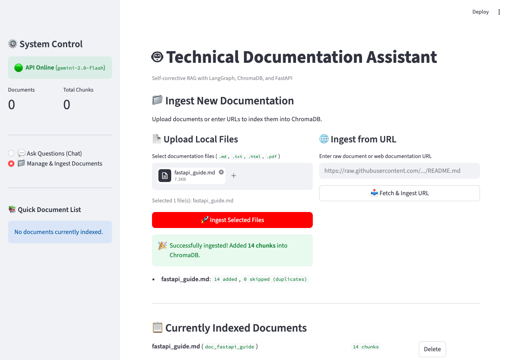
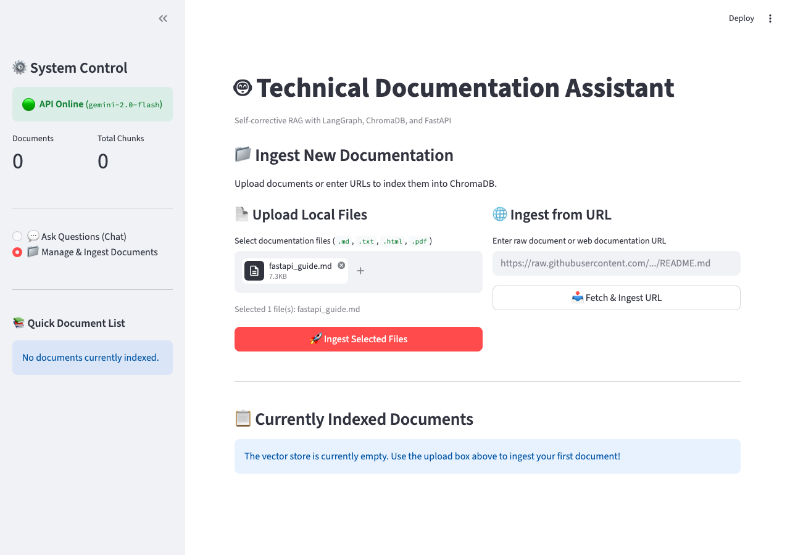
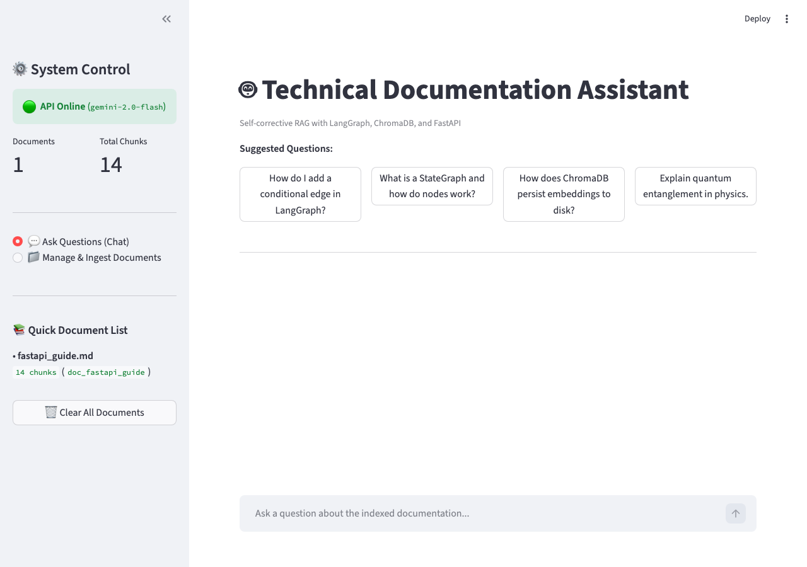

# DocuFlow AI: Production Self-Corrective RAG Assistant
### *Autonomous LangGraph Cyclic Workflow with Dynamic Query Rewriting, Document Grading & Grounded Answer Synthesis*

[](https://fastapi.tiangolo.com)
[](https://langchain-ai.github.io/langgraph/)
[](https://docs.trychroma.com)
[](https://www.python.org/)
[](DOCUMENTATION.md)
[](LICENSE)

---

> 📖 **Comprehensive System Guide**: For an exhaustive architectural breakdown, state machine node mechanics, full question handling taxonomy, trace scenarios, and technical interview Q&A, see **[DOCUMENTATION.md](DOCUMENTATION.md)**.

---

## 1. Project Overview

**DocuFlow AI** is a production-engineered, self-corrective Retrieval-Augmented Generation (RAG) assistant designed for complex technical documentation (covering LangGraph, LangChain, ChromaDB, FastAPI, and Pydantic).

Traditional (naive) RAG architectures suffer from semantic mismatch, context noise, and hallucination upon retrieval misses. DocuFlow AI overcomes these challenges by modeling document retrieval and response synthesis as an **explicit cyclic state machine** using **LangGraph `StateGraph`**:

1. **Query Analysis & Dynamic Classification**: Categorizes user intent (`conceptual`, `how-to`, `troubleshooting`, `api-reference`, `greeting`) and rewrites queries with expanded technical terminology and acronym disambiguation.
2. **Dense Vector Retrieval**: Performs cosine similarity search against a persistent **ChromaDB** store using local, privacy-preserving CPU embeddings (`all-MiniLM-L6-v2`).
3. **Batch Document Grading**: An LLM relevance gate evaluates all retrieved chunks in a single structured batch call, filtering out irrelevant noise before synthesis.
4. **Self-Corrective Feedback Loop**: If no relevant chunks pass grading, the pipeline cycles back to reformulate the query from a different angle and re-retrieves, up to a configurable ceiling (`max_retries = 2`).
5. **Grounded Answer Synthesis**: Generates accurate, well-structured technical answers strictly from verified context with inline source citations (`[Source N: file — heading]`).
6. **Graceful Fallback & Fast-Path Routing**: Pure greetings are routed instantaneously without database lookups, while queries outside the indexed corpus produce an honest, transparent general-knowledge explanation with an explicit advisory banner.

---

## 2. Architecture & State Machine

### Execution Flowchart

```
                 User Question / POST /query
                              │
                              ▼
                   ┌─────────────────────┐
                   │   query_analysis    │  ◄───────────────────────────┐
                   │  - classify query   │                              │
                   │  - rewrite & expand │                              │
                   └──────────┬──────────┘                              │
                              │ rewritten_query                         │
                              ▼                                         │
                   ┌─────────────────────┐                              │
                   │      retrieval      │                              │
                   │  - ChromaDB search  │                              │
                   │  - top-k chunks     │                              │
                   └──────────┬──────────┘                              │
                              │ retrieved_documents                     │
                              ▼                                         │
                   ┌─────────────────────┐                              │
                   │       grading       │                              │
                   │  - batch LLM grade  │                              │
                   │  - filter relevant  │                              │
                   └──────────┬──────────┘                              │
                              │                                         │
                    [route_after_grading]                               │
                    /                   \                               │
          relevant docs?             no relevant docs?                  │
                │                               │                       │
                ▼                 retry_count < max_retries?            │
     ┌────────────────────┐            /                 \              │
     │      generate      │          yes                 no             │
     │ - grounded answer  │           │                   │             │
     │ - source citations │      (retry cycle)            ▼             │
     └──────────┬─────────┘           └────────── ┌───────────────┐    │
                │                                 │   fallback    │    │
                ▼                                 │ - general AI  │    │
              [END]                               │   knowledge   │    │
                                                  └───────┬───────┘    │
                                                          │            │
                                                          ▼            │
                                                        [END]          │
```

### State Schema (`src/workflow/state.py`)

State flowing through the workflow is strictly typed using Python's native `TypedDict`:

```python
class RAGState(TypedDict):
    original_question: str          # Raw user query (never mutated)
    top_k: int                      # Configurable chunk retrieval limit
    rewritten_query: str            # Current query used for retrieval
    query_type: str                 # conceptual | how-to | troubleshooting | api-reference | greeting
    retrieved_documents: list[Doc]  # Raw chunks returned from vector store
    relevant_documents: list[Doc]   # Filtered list of LLM-graded relevant chunks
    retry_count: int                # Counter tracking self-correction cycles
    max_retries: int                # Configurable hard ceiling (default: 2)
    answer: str                     # Generated answer or fallback text
    sources: list[SourceMetadata]   # Structured citations (file, chunk ID, heading)
    generation_supported: bool      # True if answer is grounded; False if fallback
    error: Optional[str]            # Propagated error message if any step fails
```

### Routing Logic (`src/workflow/routing.py`)

```python
def route_after_grading(state: RAGState) -> str:
    if state.get("error"):
        return "fallback"
    if state.get("relevant_documents"):
        return "generate"
    if state.get("retry_count", 0) < state.get("max_retries", 2):
        return "query_analysis"   # Loops back to rewrite and re-retrieve
    return "fallback"             # Max retries exhausted
```

---

## 3. Folder Structure

```
Newproject/
├── main.py                          # Root ASGI entrypoint — uvicorn main:app --reload
├── ui.py                            # Streamlit frontend application
├── requirements.txt                 # Python dependencies
├── .env.example                     # Environment variable template
├── .gitignore
├── LICENSE
├── README.md
├── DOCUMENTATION.md                 # Exhaustive architectural & technical deep-dive
│
├── src/                             # Core application source package
│   ├── __init__.py
│   │
│   ├── core/                        # Shared configuration & settings
│   │   ├── __init__.py
│   │   └── config.py                # Pydantic Settings — loads all env vars
│   │
│   ├── api/                         # FastAPI application layer
│   │   ├── __init__.py
│   │   ├── main.py                  # FastAPI app factory, lifespan, CORS
│   │   ├── models/                  # Pydantic request/response schemas
│   │   │   ├── __init__.py
│   │   │   ├── query.py             # QueryRequest & QueryResponse models
│   │   │   ├── ingest.py            # IngestRequest & IngestResponse models
│   │   │   ├── feedback.py          # FeedbackRequest model
│   │   │   └── documents.py         # DocumentListResponse model
│   │   └── routers/                 # API route handlers
│   │       ├── __init__.py
│   │       ├── query.py             # POST /query endpoint
│   │       ├── ingest.py            # POST /ingest & POST /ingest/url endpoints
│   │       ├── feedback.py          # POST /feedback endpoint
│   │       └── documents.py         # GET /documents endpoint
│   │
│   ├── indexing/                    # Document ingestion & vector store layer
│   │   ├── __init__.py
│   │   ├── loader.py                # Markdown/HTML/PDF loaders with SSRF protection
│   │   ├── chunker.py               # Recursive text splitter with heading extraction
│   │   ├── embedder.py              # sentence-transformers embedding initializer
│   │   └── vector_store.py          # ChromaDB CRUD — add, query, delete, list
│   │
│   └── workflow/                    # LangGraph self-corrective RAG pipeline
│       ├── __init__.py
│       ├── graph.py                 # StateGraph builder — node wiring & edges
│       ├── state.py                 # RAGState TypedDict definition
│       ├── routing.py               # Conditional edge routing functions
│       ├── llm.py                   # Gemini LLM initializer
│       └── nodes/                   # Individual graph node implementations
│           ├── __init__.py
│           ├── query_analysis.py    # Node: classify intent & rewrite query
│           ├── retrieval.py         # Node: ChromaDB cosine similarity search
│           ├── grading.py           # Node: batch LLM relevance grading
│           ├── generation.py        # Node: grounded answer synthesis
│           └── fallback.py          # Node: general-knowledge fallback response
│
├── data/                            # Runtime data (feedback, screenshots)
│   ├── feedback.jsonl               # Append-only user rating log
│   └── screenshots/                 # UI showcase images
│
├── docs/                            # Documentation corpus for ingestion
│   └── corpus/
│       ├── langgraph_concepts.md
│       ├── langchain_rag.md
│       ├── chromadb_guide.md
│       ├── fastapi_guide.md
│       └── pydantic_v2.md
│
└── scripts/                         # Utility scripts
  ├── fetch_corpus.py              # Downloads raw documentation files
  └── ingest_corpus.py             # Batch-ingests corpus via POST /ingest
```
---

## 4. Technology Stack & Rationale
| **Embeddings** | `sentence-transformers/all-MiniLM-L6-v2` | Runs locally on CPU; zero API cost, zero external network dependency during retrieval, and 384-dimensional dense vectors optimal for technical prose. |
| **Vector Store** | ChromaDB (v1.5.8) | Persistent on disk (`./chroma_db`), native metadata filtering, document listing, and granular chunk deletion. |
| **Web API** | FastAPI (v0.115.0) + Uvicorn | High-performance ASGI framework with automatic OpenAPI documentation (`/docs`), Pydantic v2 schemas, and async streaming capabilities. |
| **UI Presentation** | Streamlit (v1.38.0) | High-fidelity dark glassmorphism interface with custom typography (Outfit & Plus Jakarta Sans), interactive telemetry drawer, and corpus management. |

---

## 5. Document Ingestion & Chunking Strategy

### The Technical Corpus
The assistant includes an initial corpus of technical documentation located in `docs/corpus/`:
1. `langgraph_concepts.md`: StateGraph, nodes, edges, conditional routing, state reducers.
2. `langchain_rag.md`: Document loaders, recursive splitters, retrievers, LCEL chaining.
3. `chromadb_guide.md`: Collections, distance metrics, querying, metadata filters, persistence.
4. `fastapi_guide.md`: Path operations, Pydantic schemas, dependency injection, lifespan events.
5. `pydantic_v2.md`: BaseModel, Field constraints, model_dump, custom validators, TypeAdapter.

### Chunking Rationale
- **Hierarchical Separators**: `["\n## ", "\n### ", "\n#### ", "\n\n", "\n", " "]` prioritizes splitting at section boundaries before paragraphs to avoid breaking code blocks.
- **Chunk Size (800 characters)**: Large enough to retain a full code snippet and its explanation together, yet small enough to avoid semantic drift in the embedding vector.
- **Chunk Overlap (100 characters)**: Prevents edge-truncation of important definitions spanning boundary cuts.
- **Heading Preservation**: Every chunk automatically extracts the nearest Markdown header above it (`heading` metadata), enriching the citation context.
- **Deduplication via SHA-256**: Chunks compute a SHA-256 content hash. When running `POST /ingest` multiple times, existing hashes in ChromaDB are detected and skipped automatically.

---

## 6. UI Showcase

The repository includes a modern, dark glassmorphism interface featuring custom typography, live status badges, telemetry drawers, and corpus tools:

| Interactive Dashboard | Ingestion & Document Manager |
|:---:|:---:|
|  |  |

| File Selection View | Chat Q&A with Pipeline Trace |
|:---:|:---:|
|  |  |

---

## 7. Setup & Installation

### Prerequisites
- Python 3.11, 3.12, or 3.13
- A Google Gemini API key ([Get one free at Google AI Studio](https://aistudio.google.com/app/apikey))

### 1. Clone & Set Up Virtual Environment

```bash
git clone https://github.com/abhijeetpaul57/Newproject.git
cd Newproject
python -m venv venv

# On Windows (PowerShell):
.\venv\Scripts\Activate.ps1

# On Linux/macOS:
source venv/bin/activate

pip install -r requirements.txt
```

### 2. Configure Environment Variables

Copy `.env.example` to `.env` and enter your Gemini API key:

```bash
cp .env.example .env
```

Edit `.env`:
```env
GOOGLE_API_KEY=AIzaSy...your_actual_key...
LLM_MODEL=gemini-3.8-flash
LLM_TEMPERATURE=0.0
EMBEDDING_MODEL=all-MiniLM-L6-v2
RETRIEVAL_TOP_K=5
MAX_RETRIES=2
CHUNK_SIZE=800
CHUNK_OVERLAP=100
AUTO_INGEST_CORPUS=true
```

### 3. Run the FastAPI Application

```bash
uvicorn main:app --reload --host 127.0.0.1 --port 8000
```

- API Docs (Swagger UI): `http://127.0.0.1:8000/docs`
- Redoc Interface: `http://127.0.0.1:8000/redoc`
- Health Check: `http://127.0.0.1:8000/health`

### 4. Launch the Interactive Web Interface

In a separate terminal tab, run:

```bash
streamlit run ui.py
```

The UI will automatically open at `http://localhost:8501`. Features include:
- **Interactive Chat Q&A**: Submit queries with real-time feedback and stream view.
- **Pipeline Inspector**: Expandable drawer showing the query classification, rewritten query, self-correction retry counter, and source citations.
- **Corpus Dashboard**: View all indexed documents and their chunk counts directly from the sidebar.
- **Document Management**: Drag-and-drop local file uploader (`POST /ingest`) and URL fetcher (`POST /ingest/url`).
- **One-Click Thumbs Up / Down Feedback**: Submits evaluations directly to `data/feedback.jsonl`.

---

## 8. API Reference & Examples

### 1. `POST /query`
Submit a question and receive a context-grounded answer with source citations.

**Request:**
```bash
curl -X POST "http://localhost:8000/query" \
  -H "Content-Type: application/json" \
  -d '{"question": "How do I add a conditional edge in LangGraph?", "top_k": 5}'
```

**Response (200 OK):**
```json
{
  "answer": "In LangGraph, you add a conditional edge using graph_builder.add_conditional_edges()...",
  "sources": [{"doc_id": "doc_langgraph_concepts", "source": "langgraph_concepts.md", "chunk_id": "doc_langgraph_concepts_chunk_0003", "heading": "Edges"}],
  "query_type": "how-to",
  "rewritten_query": "add conditional edges routing function LangGraph StateGraph",
  "retry_count": 0,
  "relevant_chunks_used": 2,
  "generation_supported": true,
  "error": null
}
```

---

### 2. `POST /ingest`
Upload files (`.md`, `.txt`, `.html`, `.pdf`) or ingest from URLs.

**File Upload:**
```bash
curl -X POST "http://localhost:8000/ingest" -F "files=@my_new_doc.md"
```

**URL Ingestion:**
```bash
curl -X POST "http://localhost:8000/ingest/url" \
  -H "Content-Type: application/json" \
  -d '{"urls": ["https://raw.githubusercontent.com/langchain-ai/langgraph/main/README.md"]}'
```

---

### 3. `GET /documents`
List all indexed documents, chunk distributions, and timestamps.

```bash
curl -X GET "http://localhost:8000/documents"
```

---

### 4. `POST /feedback`
Record user thumbs-up/down ratings and qualitative comments.

```bash
curl -X POST "http://localhost:8000/feedback" \
  -H "Content-Type: application/json" \
  -d '{"rating": "thumbs_up", "comment": "Accurate explanation.", "question": "How do I add a conditional edge in LangGraph?"}'
```

---

## 9. Design Decisions & Engineering Trade-Offs

### 1. Local Embeddings vs. Cloud API Embeddings
- **Decision**: Used `all-MiniLM-L6-v2` locally via `sentence-transformers`.
- **Reasoning**: Eliminates secondary API keys, runs completely offline without network latency, and produces reliable 384-dimensional cosine representations for technical docs.
- **Trade-off**: Slightly lower context representation than OpenAI `text-embedding-3-small`, but completely free and has zero external failure points.

### 2. ChromaDB vs. FAISS
- **Decision**: Selected ChromaDB with persistent disk storage.
- **Reasoning**: ChromaDB natively stores structured metadata per chunk and provides query filters required for the `GET /documents` endpoint and deduplication.
- **Trade-off**: ChromaDB has slightly more process overhead than raw FAISS index matrices, but avoids the complex custom disk serialization and manual metadata indexing required with FAISS.

### 3. `src/` Package Layout
- **Decision**: Organized all application code under a top-level `src/` package with sub-packages (`core`, `api`, `indexing`, `workflow`).
- **Reasoning**: Enforces clean separation of concerns and aligns with Python packaging best practices (`pyproject.toml`-ready).
- **Trade-off**: Requires a thin root `main.py` entrypoint, but eliminates circular-import risks common in flat project layouts.

### 4. Retry Limit of 2
- **Decision**: Fixed `max_retries = 2`.
- **Reasoning**: A 1st retry handles terminology mismatch (e.g. acronyms vs spelled out). A 2nd retry tries a broader conceptual query. On a specialized 5-document local corpus, a 3rd attempt is statistically unlikely to discover unindexed material and would inject 3–5 seconds of unnecessary latency.

### 5. Feedback Persistence
- **Decision**: Append-only JSONL format (`data/feedback.jsonl`).
- **Reasoning**: Completely durable against server crashes, zero configuration required, and atomic in nature. Feedback is collected for offline evaluation and quality monitoring.

---